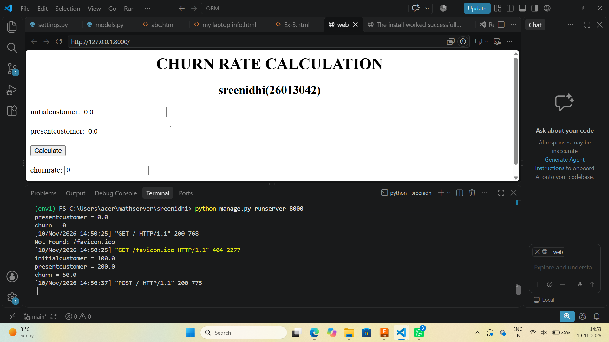
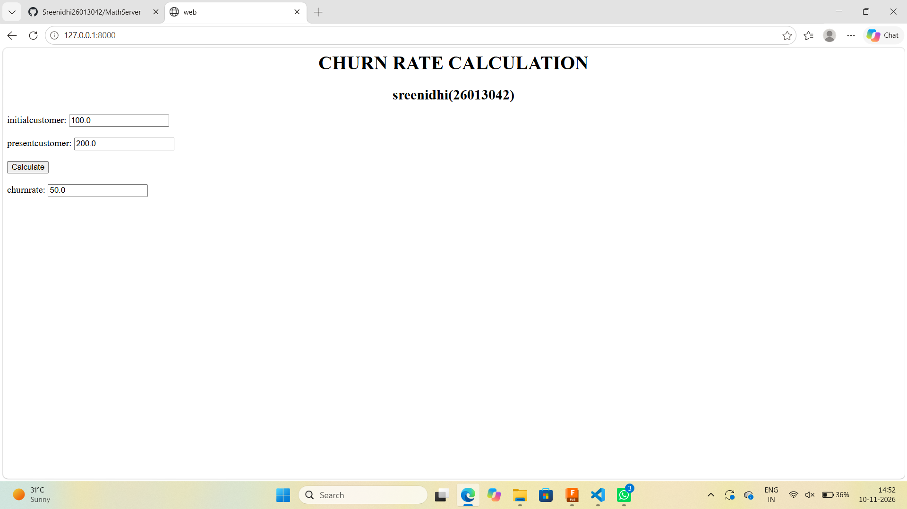

# Ex.03 Design a Website for Server Side Processing
## Date:10.11.26


## AIM:
To create a web page to calculate Churn Rate using server-side scripts.

## FORMULA:
Churn Rate = (CustLost / InitCust) * 100
<br> InitCust --> Initial Customers Count
<br> CustLost --> Customers Lost Count

## DESIGN STEPS:

### Step 1:
Clone the repository from GitHub.

### Step 2:
Create Django Admin project.

### Step 3:
Create a New App under the Django Admin project.

### Step 4:
Create a HTML file to implement form based input and output.

### Step 5:
Create python programs for views and urls to perform server side processing.

### Step 6:
Receive input values from the form using request.POST.get().

### Step 7:
Calculate the Result using the given formula.

### Step 8:
Display the calculated result in the server console.

### Step 9:
Render the result to the HTML template.

### Step 10:
Publish the website in Localhost.

## PROGRAM:
```
mathserver.html
<html>
    <head>
        <title>web</title>
    </head>
    <body>
        <h1 align="center">CHURN RATE CALCULATION</h1>
        <h2 align="center" >sreenidhi(26013042)</h2>
        <form method="post">
            
            <label>initialcustomer:</label>
            <input type ="number" value="{{initial_customer}}" name="initialcustomer"><br><br>
            <label>presentcustomer:</label>
            <input type="number" value="{{present_customer}}" name="presentcustomer"><br><br>
            <input type="submit" value="Calculate"><br><br>
            <label>churnrate:</label>
            <input type="number" value="{{churn}}"><br><br>
        </form>
    </body>
</html>

views.py
from django.shortcuts import render
def churn_bill(request):
    initial_customer = float(request.POST.get('initialcustomer', '0'))
    present_customer= float(request.POST.get('presentcustomer', '0'))
    churn =   (initial_customer/present_customer)*100 if request.method == 'POST' else 0
    
    print("initialcustomer =",initial_customer)
    print("presentcustomer =",present_customer)
    print("churn =",churn)
    return render(request, 'sreeapp/mathserver.html',{'initial_customer':initial_customer, 'present_customer': present_customer, 'churn': churn})


urls.py
from django.contrib import admin
from django.urls import path
from sreeapp import views

urlpatterns = [path('', views.churn_bill, name='churn_bill'),]
```

## OUTPUT - SERVER SIDE:

## OUTPUT - WEBPAGE:



## RESULT:
The the web page to calculate Churn Rate using server-side scripts is created successfully.
